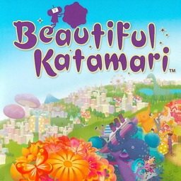

<h1 align=center>Beautiful Katamari — Nintendo Switch port</h1>

<b>katamari-nx 1.0.2</b> · <a href="https://chanseyisthebest.github.io/katamari-nx-installer/">web installer</a> · <a href="https://github.com/ChanseyIsTheBest/katamari-nx/releases/tag/v1.0.2">release</a>

An unofficial native port of the Xbox 360 version of **Beautiful Katamari** (Namco Bandai Games, 2007), with its
downloadable content, made by static recompilation with [ReXGlue](https://github.com/rexglue/rexglue-sdk) and drawn by
[reNut](https://github.com/masterspike52/reNut)'s renderer on deko3d. No emulator.

This repository contains no game files and no code generated from the game. You need your own copy of the game: the
Xbox 360 disc image (`.iso`, the NTSC-U release); the DLC packages (`Content/<profile>/4E4D07DC/00000002`) are optional.

## Playing it on the Switch

1. Open the web installer: **https://chanseyisthebest.github.io/katamari-nx-installer/**
2. Choose your disc image (with the DLC package files if you have them) or a folder you extracted the game into, and
   press **Create katamari-nx.zip**. It runs in your browser; your game files never leave your computer.
3. Extract `katamari-nx.zip` into `sdmc:/switch/` (it makes `switch/katamari-nx/`).
4. Start it with a game override (hold **R** while starting an installed title) or a forwarder set to a
   **39-bit address space**.

- Album applet mode does not give the game enough memory.
- **Updating from 1.0.1:** make a new `katamari-nx.zip` on the installer page, delete the old
  `switch/katamari-nx/game_root/` folder (1.0.2 packs and re-encodes the game's files), then extract the zip over your
  folder. Your `katamari.toml` and saves stay. 1.0.1 unpacked the DLC into
  `switch/katamari-nx/renut/0000000000000000/4E4D07DC/00000002/`: 1.0.2 reads the packages in `dlc/` instead, so those
  folders can be deleted (keep `Headers/`).
- **The first time you play** after installing, the game compiles the shaders the installer did not prepare as it meets
  them, so it can stutter for a moment in new places. Later sessions start smoothly.

Features:

- The DLC: the stage packs always load; the packs that only unlock items are optional.
- Two players: every controller is its own player (handheld counts as one); single Joy-Cons held sideways, one per
  player. **L + R + ZR** opens the system's controller screen.
- Face buttons by position, as on the Xbox 360 pad (Switch B = Xbox A, A = B, Y = X, X = Y), or by letter.
- 720p handheld, 1080p docked, at stock clocks on three cores. The hub and menus hold 60 fps; the biggest stages drop
  below that.
- Smaller on the SD card: the installer packs the game's files (LZ4, the movies ZXC), re-encodes the music and voices
  to Opus, and can re-encode the movies to H.265, which the Switch's video hardware plays: about 1.6 GB instead of
  2.9 GB.
- The DLC is read in place from `dlc/`, and the installer writes the game folder's index, so the first start skips
  the folder scan.
- 4x MSAA (the game's own edge smoothing) by default.
- Release built with link-time optimisation and PGO, the profile taken from a session on the console.

## Settings

`switch/katamari-nx/katamari.toml` holds only your options (deleted, it is written again with the defaults):

| Setting | What it does |
| --- | --- |
| `msaa_level` | Edge smoothing samples: `4` (the game's own, default), `2` or `1` (off) |
| `frame_cap` | `"Off"` (uncapped, as on the Xbox 360; default) or `"30"` |
| `user_language` | `1` English (default), `2` Japanese |
| `katamari_dlc_unlock_packs` | Also load the DLC packs that only unlock what the game unlocks itself (`false`, default) |
| `input_xbox_layout` | Face buttons by position (`true`, default) or by letter (`false`) |
| `input_joycon_sideways` | Single Joy-Cons held sideways, one per player (`true`, default) |
| `input_joycon_sideways_stick` | The single Joy-Con's stick turned for the sideways grip (`true`, default) |
| `[input_p1]`, `[input_p2]` | Each player's buttons, e.g. `a = "B, ZR"` |

## Building

Needs Windows, LLVM clang and the VS Build Tools (PC build); devkitA64, libnx and deko3d from
[devkitPro](https://devkitpro.org) (Switch); Python; and your own copy of the game (for the code generator and the
shaders). The whole process is in [docs/building.md](docs/building.md).

- `app/`: the game (hooks, renderer, native functions, settings, CMake project)
- `sdk/`: the ReXGlue SDK with the Horizon layer and the code generator changes
- `tools/`: code generation, build, test, shader and analysis scripts
- `pgo-inplace/`: the PGO profile of the released NRO (counts of which code ran, no game code or data); `pgo/` is
  1.0.0's, for the build without the machine copies in place
- `dist/`: the test builds' settings
- `docs/`: [katamari-notes.md](docs/katamari-notes.md) (the port step by step), [building.md](docs/building.md),
  [ultimate-fixes.md](docs/ultimate-fixes.md) and [changelog.md](docs/changelog.md) (what came from the other ports),
  [optimising-functions.md](docs/optimising-functions.md), [codegen-crash-fixes.md](docs/codegen-crash-fixes.md),
  [progress-log.md](docs/progress-log.md), [console-rc9-breakdown.md](docs/console-rc9-breakdown.md)

## Credits and license

- **Namco Bandai Games**: creators of Beautiful Katamari. This is an unofficial, fan-made port with no affiliation.
- **ChanseyIsTheBest**: this port.
- **[Tom Clay](https://github.com/rexglue/rexglue-sdk)**: the ReXGlue SDK, built on the work of the
  **[Xenia](https://xenia.jp)** team.
- **[StevensND](https://github.com/StevensND/nfsmw-nx)**: nfsmw-nx (the SDK's Switch layer and much of the method) and
  [nfsmw-nx-installer](https://github.com/StevensND/nfsmw-nx-installer), the installer page this port's is built on.
- **[nebadasSwifty](https://github.com/nebadasSwifty/masseffect-nx)**: masseffect-nx.
- **[hedge-dev](https://github.com/hedge-dev/XenosRecomp)**: XenosRecomp, the Xenos shader translator.
- **reNut and [masterspike52](https://github.com/masterspike52/reNut)**: reNut's Direct3D-level renderer (reused with
  its author's permission).
- **[plume](https://github.com/renderbag/plume)** (from UnleashedRecomp), **[deko3d](https://github.com/devkitPro/deko3d)**
  and **[uam](https://github.com/devkitPro/uam)** by fincs, with SwitchWakerHD's uam patches.
- **[devkitPro](https://devkitpro.org) and [switchbrew](https://github.com/switchbrew/libnx)**: devkitA64 and libnx.
- The sibling ports that share their fixes: [renut-nx](https://github.com/ChanseyIsTheBest/renut-nx) (this port's
  base), [sa2-nx](https://github.com/ChanseyIsTheBest/sa2-nx), [futari-nx](https://github.com/ChanseyIsTheBest/futari-nx),
  Peggle 2, Sonic & All-Stars Racing Transformed, [kameo-nx](https://github.com/ChanseyIsTheBest/kameo-nx), Pac-Man
  Championship Edition DX, and the Torchlight port's findings on 2 MB blocks.
- The ports whose fixes 1.0.2 takes through the ultimate base (docs/ultimate-fixes.md names each): among them rr6-nx
  (the LZ4 / ZXC game files, the DLC read in place), sasrt-nx (Sonic & All-Stars Racing Transformed: the media guide,
  the render thread), culdcept-nx (the Opus sounds, the H.265 movies on NVDEC, the two-size folder index), blur-nx,
  banjo-nx, vivapinata-nx (the movie hook) and the Cave ports.
- **[KhronosGroup](https://github.com/KhronosGroup/SPIRV-Cross)**: SPIRV-Cross.
- The other libraries listed in [THIRD_PARTY_NOTICES.md](THIRD_PARTY_NOTICES.md).

GPL-3.0 (see [LICENSE](LICENSE)), like the ports it builds on; the SDK keeps its BSD-3-Clause license (see
[THIRD_PARTY_NOTICES.md](THIRD_PARTY_NOTICES.md)).

No affiliation with Bandai Namco, Microsoft or Nintendo. "Beautiful Katamari" is a trademark of Bandai Namco
Entertainment; the icon is its cover artwork. Everything made from your copy (`app/generated/`, the shaders) is made on
your own computer. Running homebrew requires custom firmware, which violates Nintendo's ToS and can get a console banned:
your call.
